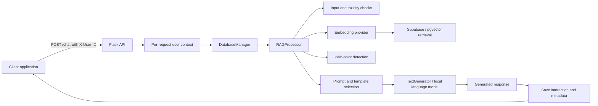

# Psy-Supabase Architecture Overview

> **Purpose:** explain the repository as a set of human-readable concepts while preserving a clear distinction between implementation facts, inferred intent, and unverified claims.

## One-sentence system description

Psy-Supabase is a Flask-based Python backend that converts a user's message into a semantic embedding, retrieves relevant conversation and knowledge context from Supabase/pgvector, chooses a therapeutic-response template or approach, generates an answer with a local language model, and saves the interaction.

## Primary runtime flow

## Conceptual layers

| Layer | Main implementation | Human-readable responsibility |
|---|---|---|
| HTTP boundary | `psy_supabase/main.py` | Accept chat and monitoring requests, establish user/database context, and expose health and memory endpoints |
| Package entry point | `psy_supabase/__main__.py` | Start the Flask application |
| Conversation orchestration | `psy_supabase/core/rag_processor.py` | Coordinate validation, embeddings, retrieval, context assembly, pain-point analysis, and response generation |
| Persistence and vector search | `psy_supabase/core/database.py` | Store interactions and knowledge and perform pgvector similarity operations |
| Dynamic retrieval | `psy_supabase/core/dynamic_rag.py` | Retrieve knowledge and conversation context while a response is being assembled |
| Response planning | `psy_supabase/core/response_generator.py`, `psy_supabase/utilities/prompt_selector.py` | Select context, templates, and prompts |
| Model management | `psy_supabase/core/model_manager.py`, `psy_supabase/core/text_generator.py` | Load, cache, move, and invoke text and embedding models |
| Recurring-concern analysis | `psy_supabase/core/pain_point_detector.py`, monitoring code in `main.py` | Detect repeated themes and maintain session-level analytics |
| Associative memory | `psy_supabase/memory/` | Hold and retrieve relationships between concepts |
| Safety | `psy_supabase/utilities/safety_handler.py`, toxicity checks | Reject or transform unsafe or invalid input |
| Operations | `model_manager.py`, `main.py`, logging utilities | Handle CPU/CUDA selection, cleanup, downloading, and status reporting |

## Main `/chat` execution path

1. `before_request` reads `X-User-ID` and initializes `DatabaseManager`.
2. `chat()` loads or obtains the configured model generator.
3. `RAGProcessor.generate_response()` validates input and checks toxicity.
4. The user's text is converted to an embedding.
5. Recent conversation context and semantically similar interactions are collected.
6. The RAG processor detects pain points or repeated themes.
7. Topics and emotions are analyzed, and a template or approach is selected.
8. Knowledge documents and conversation context are assembled into the generation prompt.
9. The text generator produces a response.
10. The interaction, context, and metadata are saved to the database.
11. Optional monitoring data is added to the API response.

## The three kinds of information combined

### Retrieved evidence

Recent conversation exchanges and documents found by pgvector similarity are externally stored materials supplied to the response pipeline.

### Inferred labels

Topics, emotional state, recurring themes, pain-point status, and therapeutic approach are product-specific classifications and may be probabilistic or heuristic.

### Generated prose

The language model produces the final conversational reply. This output should not be confused with verified factual or clinical evidence merely because it is accompanied by retrieved context.

## Invariants supported by the implementation

- The package is Python-centered, with Flask and Hugging Face/SentenceTransformer dependencies.
- `/chat` requires `X-User-ID` for normal protected requests.
- The database manager is initialized per request and scoped by user.
- The pipeline includes database retrieval, embedding generation, optional pain-point detection, prompt/context assembly, and persistence stages.
- Fallback text exists for invalid, toxic, or error paths.
- Tests cover unit behavior and mocked integration paths.

## Claims not established by the repository alone

- That `X-User-ID` is cryptographically authenticated rather than merely supplied as a caller identifier.
- That every generated answer is therapeutically appropriate.
- That all vector dimensions are consistently compatible across model fallbacks.
- That persisted session data is isolated according to every deployment's security requirements.
- That the test suite represents clinical evidence or real-world safety validation.

## Test-derived behavioral map

| Concept | Representative tests | Behavioral meaning |
|---|---|---|
| Embedding cache | `tests/test_rag_processor.py` | A cached vector can prevent re-generation for a matching query |
| Vector retrieval | `tests/test_rag_processor.py` | Relevant documents can be retrieved and added to context |
| Pain-point detection | `tests/test_pain_point_detection.py` | Empty, insufficient, realistic, and failing database histories should return safely defined results |
| Semantic chunking | `tests/test_pain_point_detection.py` | Long or multi-sentence text should preserve meaningful content |
| RAG orchestration | `tests/test_rag_processor.py` | Retrieved context and pain-point results feed the response pipeline |
| Safety fallbacks | RAG and response test coverage | Toxic or malformed paths should not crash the public request path |
| Template selection | RAG approach tests | A detected pattern can influence the response template |

## Key risks

1. **Identity and authorization:** establish whether `X-User-ID` is server-authenticated and whether database operations prevent cross-user access.
2. **Privacy:** in-memory sessions and Supabase storage may retain sensitive conversation data.
3. **Therapeutic safety:** crisis detection and toxicity handling require explicit clinical and operational policy evaluation.
4. **Embedding consistency:** primary and fallback embeddings may differ in dimensions or semantics.
5. **Prompt correctness:** retrieved documents must not be presented in prompts in misleading or unsafe ways.
6. **Reliability:** broad exception handling can turn severe failures into fallback responses that are difficult to distinguish.
7. **Test quality:** some tests verify output type or non-`None` values rather than psychological quality or semantics.

## Recommended reading order

1. `README.md` for project intent and limitations
2. `psy_supabase/main.py` for HTTP behavior
3. `psy_supabase/core/rag_processor.py` for orchestration
4. `psy_supabase/core/database.py` for storage and retrieval contracts
5. `psy_supabase/core/response_generator.py` and `text_generator.py` for generation behavior
6. `psy_supabase/core/pain_point_detector.py` for recurring-theme logic
7. `tests/test_rag_processor.py` and `tests/test_pain_point_detection.py` for behavioral guarantees
