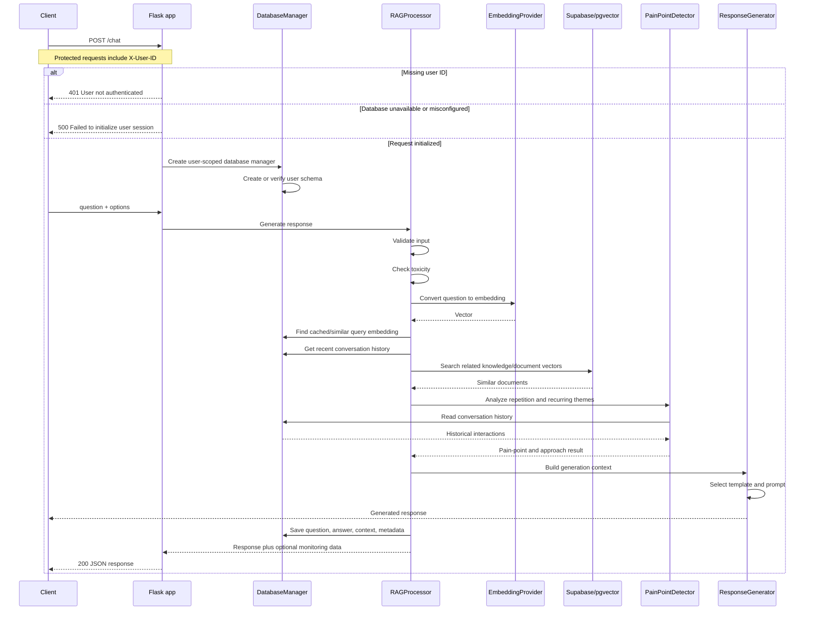

# Psy-Supabase: `/chat` Request Flow

This page describes one protected chat request as a sequence of responsibilities. It is based on the implementation, not an assumption that every component is production-ready.

## Stage boundaries

### 1. Request initialization

`before_request()` in `psy_supabase/main.py`:

- skips public endpoints that do not need authentication;
- requires `X-User-ID` for protected paths;
- creates `DatabaseManager` in Flask's request-local `g` object;
- attempts synchronous user-schema creation.

This is a user-context boundary, but the source alone does not prove that `X-User-ID` was obtained through a trusted authentication system.

### 2. Input and safety checks

`RAGProcessor.generate_response()` validates input and performs toxicity-related checks before retrieval and generation.

The implementation provides fallback branches for invalid input, harmful content, unavailable context, and processing exceptions. These branches are resilience mechanisms, not clinical safety certification.

### 3. Embedding

The query is transformed into a vector by `EmbeddingProviderAdapter`.

The implementation can:

- search for a similar cached database embedding;
- generate an embedding with the primary model;
- fall back to a SentenceTransformer;
- return a zero vector when generation fails.

The key invariants to verify are dimension consistency and whether a cache hit is compatible with the current query and database schema.

### 4. Context retrieval

The system combines recent conversation, semantically similar past interactions, knowledge documents, hot topics, theme clusters, emotional trajectories, and optional associative-memory retrieval.

Source labels should be retained so retrieved text is not presented as one undifferentiated authoritative fact set.

### 5. Pain-point or recurring-theme analysis

This is an inference stage. It compares conversation history or embeddings and may contribute an approach such as anxiety exploration or gentle refocus.

A detected pain point should be distinguished from a diagnosis, established cause, objective fact about the user, or current safety crisis.

### 6. Response planning

The response generator receives the user's question, topic/emotion context, pain-point results, retrieved knowledge, conversation context, hot topics, and selected templates or approaches.

A template is a prompt-generation choice, not a guarantee of clinical effectiveness.

### 7. Generation and persistence

The text generator returns a string. The interaction is saved with its context and metadata.

Persistence creates privacy, retention, and authorization obligations, especially because conversations may contain sensitive material.

## Failure semantics

The public chat endpoint attempts to return a user-facing fallback rather than leaking an exception. A caller cannot always distinguish normal answer generation, safety-blocked input, fallback due to an internal failure, weak retrieval, or template use despite unavailable context.

A machine-readable status or stage label would make degraded behavior explicit and easier to monitor.
